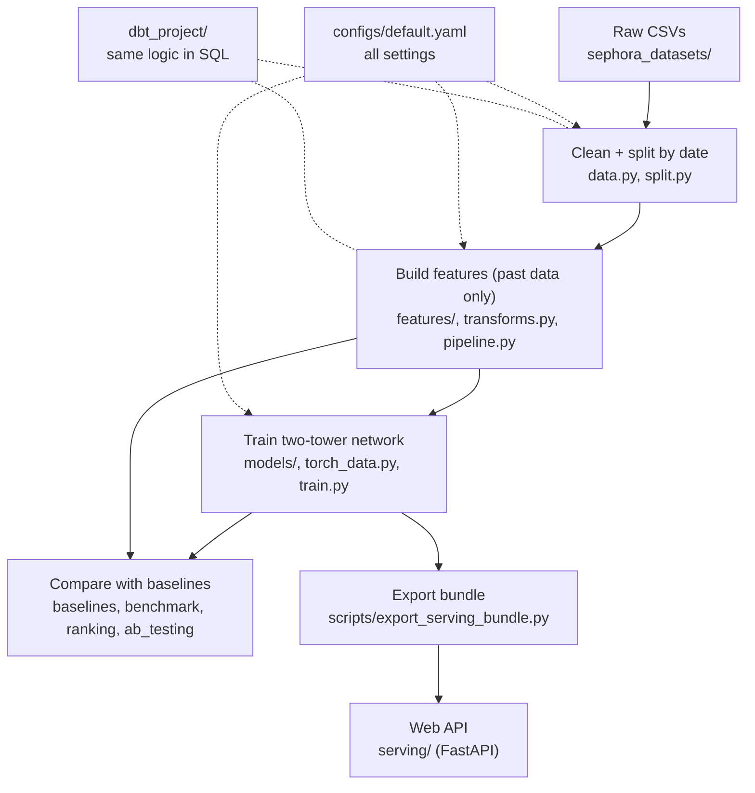

# How this project fits together

A guide for finding your way around. Start with the picture, then use the tables to look up any file.
Every Python file and function also starts with a plain-English docstring ("In plain words: ...").

## The one-minute story

We have Sephora product reviews. The goal: **predict the star rating a user would give a product**, and
check honestly whether a neural network does that better than simple averages.

1. **Clean** the raw reviews and **split them by date** (oldest = train, newest = test).
2. **Build features**: numbers describing each user and each product, using *only what was known before
   that review* (so the model can never peek at the answer).
3. **Train** a "two-tower" neural network.
4. **Compare** it with simple baselines, with statistical tests.
5. **Serve** it through a small web API.

Files written along the way (all git-ignored except `results/` and `artifacts/serving/`):

| Step | Command | Writes |
|---|---|---|
| 1 | `python -m scripts.prepare_data` | `data_cache/interactions.parquet` |
| 2 | `python -m scripts.build_features` | `data_cache/features/` |
| 3 | `python -m scripts.train` | `runs/latest/model.pt` |
| 4 | `python -m scripts.evaluate` / `compare_methods` | `runs/latest/results.md`, `results/ab_test.*` |
| 5 | `python -m scripts.export_serving_bundle` | `artifacts/serving/` |

## Top-level folders

| Folder | What it is |
|---|---|
| `src/` | **All the logic.** Everything reusable lives here and is unit-tested. |
| `scripts/` | Thin command-line wrappers: each one is a "button" that calls `src/`. |
| `notebooks/` | A demo notebook that only *calls* `src/` (a test fails if it defines functions). |
| `configs/` | `default.yaml`: every setting (split dates, model size, learning rate, ...). |
| `tests/` | Automatic checks, including the anti-leakage tests. Run with `pytest`. |
| `dbt_project/` | The Snowflake data-warehouse layer: cleaning and "as-of" aggregates in SQL. |
| `results/` | Result tables written by the evaluation scripts. |
| `artifacts/serving/` | The ready-to-load package for the web API (model + preprocessing + catalogue). |
| `docs/` | This guide. |

## `src/` file by file

### 1. Data
| File | In plain words |
|---|---|
| `data.py` | Loads the raw CSVs and cleans them: drops broken user ids, removes duplicate scrapes, keeps each user's latest review per product. |
| `split.py` | Cuts the reviews by date into train / validation / test and checks nothing from the future leaks into the past. |
| `preprocessing.py` | Turns messy size text ("1.7 oz / 50 mL") into millilitres. |

### 2. Features
| File | In plain words |
|---|---|
| `features/asof.py` | **The anti-leak helper.** For each review, sums what the same user/product did *earlier* only. |
| `features/user.py` | User numbers: past review count, average rating, recommend rate, text-taste vector, skin/eye/hair profile. |
| `features/item.py` | Product numbers: price, size, brand size, flags, plus past review count and average rating. |
| `features/text.py` | Turns review text into short number vectors (TF-IDF, then SVD). |
| `transforms.py` | Preprocessing learned on train only: scale, fill gaps, one-hot encode, map ids to integers. |
| `pipeline.py` | Glue: runs everything in the safe order and bundles the result as a `FeatureSet`. |

### 3. Model
| File | In plain words |
|---|---|
| `models/two_tower.py` | The network: one tower for users, one for products; rating = average + user offset + product offset + how well the two vectors match. |
| `torch_data.py` | Holds a split as tensors and serves it in batches. |
| `train.py` | Training loop with early stopping on validation error. |

### 4. Evaluation
| File | In plain words |
|---|---|
| `baselines.py` | The simple methods to beat (overall / product / user average, bias model, as-of, item-kNN). |
| `evaluate.py` | RMSE and MAE, overall and by how much history the user had. |
| `ranking.py` | "Which product next?" test over the whole catalogue (HR@k, NDCG@k, MRR). |
| `benchmark.py` | Runs every method on val/test and collects the tables. |
| `ab_testing.py` | Is the difference real? Resamples whole users (bootstrap) to get honest uncertainty. |

### 5. Serving
| File | In plain words |
|---|---|
| `serving/bundle.py` | The package the API loads: model + preprocessing + precomputed catalogue snapshot. |
| `serving/recommender.py` | Turns one user's reviews into a score for every product (same feature code as training). |
| `serving/schemas.py` | The exact shape of API requests and responses. |
| `serving/api.py` | The FastAPI app: `/health`, `/recommendations`, `/predict`. |

### 6. Support
| File | In plain words |
|---|---|
| `config.py` | Reads `configs/default.yaml`. |
| `seed.py` | Makes runs repeatable; picks CPU or GPU. |
| `similarity.py` | Finds look-alike products from their learned vectors. |

## `scripts/`

| Script | In plain words |
|---|---|
| `prepare_data.py` | Step 1: clean data, cache it, print the split report. |
| `build_features.py` | Step 2: build and cache the features. |
| `train.py` | Step 3: train and save the best model. |
| `evaluate.py` | Step 4a: all methods on val/test, writes the results tables. |
| `compare_methods.py` | Step 4b: statistical tests of the network against each baseline. |
| `export_serving_bundle.py` | Step 5: package the model for the API. |
| `load_reviews_to_snowflake.py` | One-off: upload the review CSVs to Snowflake. |

## `tests/`

| File | What it checks |
|---|---|
| `test_features_leakage.py` | A row's features never depend on its own rating/text or on the future. |
| `test_data_split.py` | Cleaning rules and the time-based split. |
| `test_two_tower_train.py` | The model formula, training, early stopping, repeatability, saving. |
| `test_baselines_ranking.py` | Baselines, ranking metrics, the full benchmark. |
| `test_ab_testing.py` | The significance tests behave correctly. |
| `test_serving.py` | The API: request features equal training features; fast scoring equals the full model. |
| `test_dbt_asof_sql.py` | The dbt SQL (run in DuckDB) gives the same answers as the Python code. |
| `test_notebook_is_thin.py` | Notebooks only call `src/`. |
| `test_config_seed.py`, `test_preprocessing.py`, `test_similarity.py` | Small utilities. |
| `synthetic.py` | Made-up data shared by the tests. |

## `dbt_project/`

| File | In plain words |
|---|---|
| `models/staging/` | `stg_reviews`, `stg_products`: first light cleaning of the raw Snowflake tables. |
| `models/intermediate/int_interactions.sql` | One row per (user, product): the latest review. |
| `models/intermediate/split_cutoffs.sql` | The two dates that define train / val / test. |
| `models/marts/fct_interactions_asof.sql` | **Safe ML table**: each review with past-only user/product aggregates and its split. |
| `models/marts/dim_users.sql`, `dim_products.sql`, `fct_reviews.sql` | Reporting tables. They aggregate over *all* time, so do **not** use them as model features. |
| `tests/` | dbt tests that fail on time overlap, "as-of" counts that include the row itself, or duplicate pairs. |
| `analyses/verify_fct_interactions_asof.sql` | A check query with the expected figures. |

## Glossary

| Term | Meaning |
|---|---|
| **Review / interaction** | One user's rating of one product. We keep the latest one per (user, product). |
| **Split (train / val / test)** | Oldest reviews teach the model (train), a middle slice picks settings (val), the newest slice is the final exam (test). |
| **Leakage** | The model seeing information it would not have in real life (the answer itself, or the future). The main thing this project guards against. |
| **As-of / point-in-time** | Using only what was known *before* a given review. |
| **Feature** | A number describing a user or product that the model reads. |
| **Cold start** | A user or product with no earlier history. Roughly half of the test reviews. |
| **Tower** | A small neural network that turns a user's (or product's) features into a vector. |
| **Embedding / vector** | A short list of numbers that summarises something; similar things get similar vectors. |
| **Bias (offset)** | A learned "this user rates high" or "this product is liked" number. Slot 0 = unknown id, always 0. |
| **mu** | The overall average rating in the training data. |
| **Shrinkage** | Pulling a noisy average toward the overall average when it rests on few ratings. |
| **Early stopping** | Stop training when validation error stops improving, and keep the best version. |
| **RMSE** | Root mean squared error: typical size of the prediction error in stars, punishing big misses. Lower is better. |
| **MAE** | Mean absolute error: average miss in stars. Lower is better. |
| **HR@k** | Hit rate: how often the true product is in the top k. |
| **NDCG@k** | Like HR@k but gives more credit for ranking it higher. |
| **MRR** | Mean reciprocal rank: the average of 1 / (position of the true product). |
| **TF-IDF** | Scores words by how characteristic they are of a review; turns text into numbers. |
| **SVD** | A way to compress those many numbers into a few (here 64). |
| **Bootstrap** | Re-running a comparison on many random re-draws of the data to see how much the answer wobbles. Here we re-draw whole users. |
| **Holm correction** | Adjusts p-values when several comparisons are made at once. |
| **Bundle** | The folder the API loads: model, preprocessing and a catalogue snapshot. |
| **dbt** | A tool that builds warehouse tables from SQL files. Here it runs inside Snowflake. |
| **`u_` / `i_` prefixes** | Column names starting with `u_` describe the **u**ser, `i_` the **i**tem (product). |
